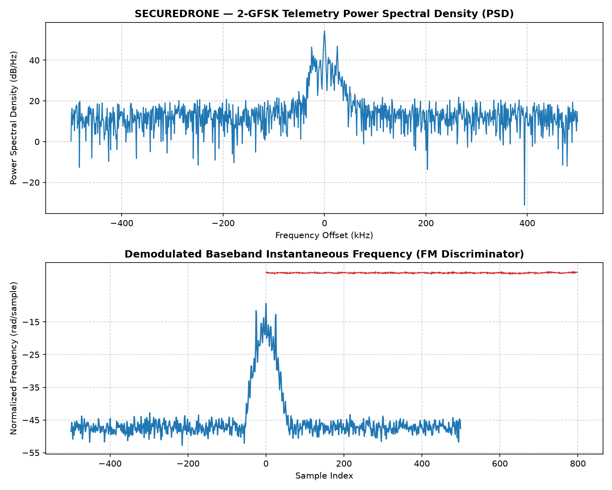
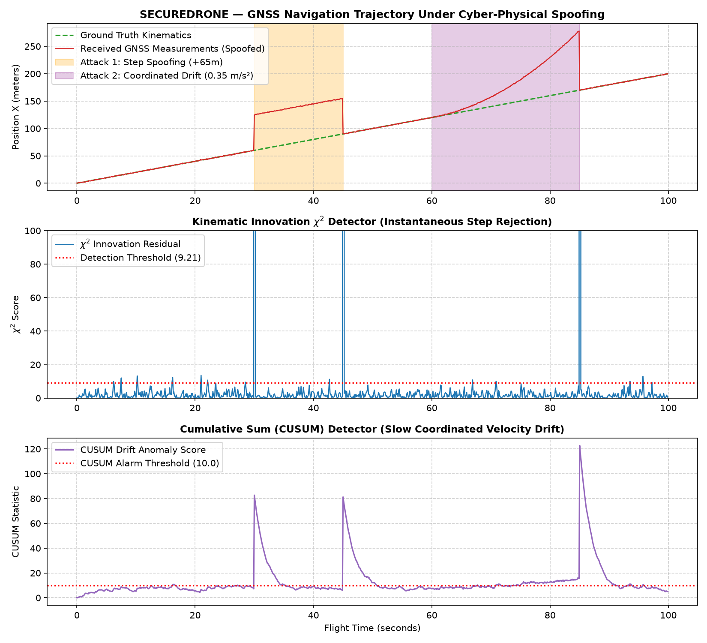

# SECUREDRONE: Open UAV Security Research & Assessment Platform


SECUREDRONE is an open-source, empirical cybersecurity engineering platform designed for verifiable research into Unmanned Aerial Vehicle (UAV) systems, communication protocols, companion computers, flight-controller firmware, and cyber-physical navigation resilience.

📖 **Comprehensive Technical Manual & Textbook**: For an exhaustive deep-dive covering protocol mechanics, mathematical proofs, firmware disassembly maps, and step-by-step auditing methodologies, consult [SECUREDRONE_MANUAL.md](SECUREDRONE_MANUAL.md).  
📄 **Academic Research Report**: See the publication-grade 5-page LaTeX technical report at [reports/securedrone_technical_report.pdf](reports/securedrone_technical_report.pdf).

---

## Quickstart & Verification

```bash
# 1. Setup Python 3.13 Virtual Environment
python3 -m venv venv
source venv/bin/activate
pip install -e .

# 2. Run Complete Automated Regression Test Suite (13 passing in <1.5s)
pytest -v

# 3. Analyze Baseline Telemetry PCAP (3,748 frames)
python tooling/cli.py analyze evidence/telemetry_recon_baseline.pcap

# 4. Execute Full MAVLink Security Assessment Suite
python tooling/cli.py audit-all
```

---

## Architecture Overview

```
+-----------------------------------------------------------------------------------+
|                              SECUREDRONE PLATFORM                                |
+-----------------------------------------------------------------------------------+
|  [Operator / GCS]                 [Security Assessor CLI]                         |
|  QGroundControl / MAVProxy   <-->  securedrone-cli (Analyzer, Signing, Replay)     |
+-----------------------------------------------------------------------------------+
                                         |
                                         | MAVLink v1/v2 (UDP 14540 / 14550)
                                         v
+-----------------------------------------------------------------------------------+
|  [Target Infrastructure]                                                          |
|  +-----------------------------+         +-------------------------------------+  |
|  | Linux Companion Computer    | <=====> | PX4 SITL / Hardware Autopilot       |  |
|  | (API, mavlink-router, socat)| (Serial)| (Flight Management Unit Core)       |  |
|  +-----------------------------+         +-------------------------------------+  |
+-----------------------------------------------------------------------------------+
                                         |
                       +-----------------+-----------------+
                       |                                   |
                       v                                   v
        +-----------------------------+     +-----------------------------+
        | Offline RF & IQ Analysis    |     | Production Firmware Audit   |
        | (Modulation, Framing, GNSS) |     | (Ghidra, Memory Mapping)    |
        +-----------------------------+     +-----------------------------+
```

---

## Six-Stage Research Architecture

1. **Stage 01 — UAV Simulation & Protocol Reconnaissance**: Headless PX4 SITL orchestration, MAVLink v1/v2 framing breakdown, endpoint mapping, telemetry capture.
2. **Stage 02 — MAVLink Security Assessment Framework**: Original modular Python assessment suite: protocol parsing, MAVLink 2 cryptographic signing auditing, replay resistance analysis, parameter security checks, and trust-boundary mapping.
3. **Stage 03 — Companion Computer & Linux Security**: Containerized companion environment, API authorization review, service privilege isolation, and serial bridge filtering.
4. **Stage 04 — Firmware Reverse Engineering**: Production autopilot binary analysis (.px4 / .apj), container unpacking, CPU architecture validation, memory layout recovery, and Ghidra disassembler auditing.
5. **Stage 05 — RF & Cyber-Physical Security**: Offline IQ signal analysis, modulation identification (FSK/GFSK), link-layer framing extraction, synthetic GNSS anomaly generation, and failsafe transition verification.
6. **Stage 06 — Formal UAV Security Assessment**: Industry-standard threat modeling (DFD, trust boundaries), CVSS v3.1/v4.0 scored findings register, defensive remediation, and regression verification.

---

## Repository Structure

```
SECUREDRONE/
├── infrastructure/         # PX4 SITL setup, companion-computer containers, networking
├── mavlink-security/       # Modular MAVLink security assessment engine
│   ├── analyzer/           # Protocol parsing & frame decoding
│   ├── signing/            # MAVLink 2 cryptographic signature validation
│   ├── replay/             # Replay attack resilience evaluation
│   ├── parameters/         # Parameter access control & validation audit
│   ├── authorization/      # Trust-boundary & endpoint authorization checks
│   └── tests/              # Automated unit and regression test suite
├── companion-security/     # Companion computer vulnerable & hardened service models
├── firmware-analysis/      # Firmware extractors, memory maps, and Ghidra analysis notes
├── rf-analysis/            # Offline IQ signal processing notebooks & frame decoders
├── navigation-security/    # GNSS synthetic generation, spoofing anomaly detection
├── tooling/                # Unified CLI entrypoints
├── evidence/               # Structured PCAPs, logs, and cryptographic traces
└── reports/                # Formal vulnerability reports & remediation records
```

---

## Core Engineering Principles

- **Empirical Evidence**: Every claim must be backed by reproducible execution output, PCAPs, or cryptographic verification traces.
- **Honest Scope**: Clear demarcation between SITL simulation, containerized Linux findings, static firmware analysis, and physical flight-controller boundaries.
- **Defensive Focus**: Every vulnerability assessment includes recommended remediation, secure configuration, and regression test suites.
- **Zero Real-World Harm**: Strictly contained within simulated environments, authorized containers, and public offline datasets.

---

## Empirical Visual Evidence & Benchmarks

| 2-GFSK IQ Telemetry Demodulation & PSD | Multi-Layer GNSS Spoofing Detection & Failsafes |
| :---: | :---: |
|  |  |
| *Quadrature FM discrimination & bitstream recovery* | *Kinematic innovation $\chi^2$ & CUSUM drift failsafes* |

---

## Deliverables Package

For evaluators and researchers seeking a standalone deliverables folder, see [`AbhishekLimaye_SecureDrone/`](AbhishekLimaye_SecureDrone/INDEX.md):
- `securedrone_technical_report.pdf`: Publication-grade 5-page research report.
- `telemetry_recon_baseline.pcap`: Raw 3,748-frame Wireshark network capture.
- `arducopter_pixhawk4.apj`: Decompressed production firmware and Ghidra loader guide.
- Complete machine-readable audit reports and high-resolution plots.

---

## Citation

If you reference this platform, methodology, or datasets in your research:

```bibtex
@misc{limaye2026securedrone,
  author = {Abhishek Limaye},
  title = {{SECUREDRONE: Open UAV Security Research & Assessment Platform}},
  year = {2026},
  publisher = {GitHub},
  howpublished = {\url{https://github.com/AbhishekLimaye/UAV-Security-Lab}}
}
```

